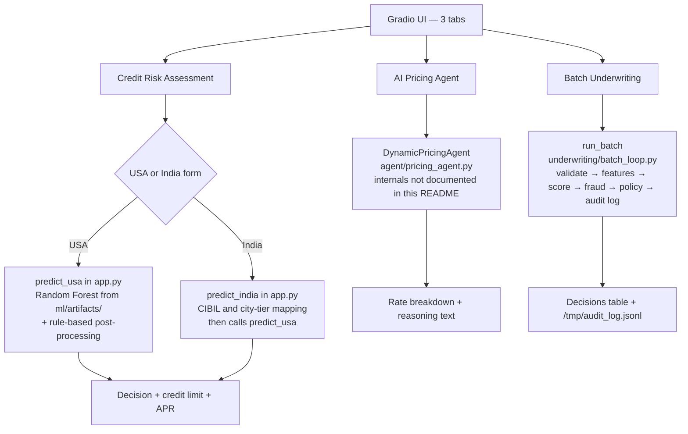

# 💳 CreditAI Global — Credit Approval System

Gradio app for USA 🇺🇸 and India 🇮🇳 credit assessment, with an AI pricing agent and a batch underwriting loop.

🔗 **Live Demo:** [huggingface.co/spaces/sivasaiatchyut/creditai-global](https://huggingface.co/spaces/sivasaiatchyut/creditai-global)

---

## 🎥 Walkthrough

### USA Credit Application


### USA — Full Form with Prediction


### USA — Assessment Result (Approved, Medium Risk)


### India Credit Application (HDFC Credila Style)


### India — Assessment Result (Approved, ₹52,954 Credit Limit)


---

## 🎯 What It Does

Three tabs, all served by one Gradio app:

| Tab | What it does | Where the decision comes from |
|---|---|---|
| 💳 Credit Risk Assessment | Scores a single applicant (USA or India form) | Random Forest from `ml/artifacts/credit_model.joblib` + rule-based grade adjustment, probability scaling, and threshold-based decision |
| 🤖 AI Pricing Agent | Returns a rate recommendation with risk / market / profit breakdown | `DynamicPricingAgent.calculate_rate()` in `agent/pricing_agent.py` — weights and internal logic not documented in this README |
| 📦 Batch Underwriting | Processes a JSON array of records through validate → features → score → fraud → policy, and writes an audit log | `run_batch()` in `underwriting/batch_loop.py` — scoring method not documented in this README; the UI text calls it a "rule-weighted probability (replaceable with ML model)" |

**USA inputs:** Credit Grade (A–G), DTI, utilization, employment length, payment history, revolving balance, open accounts, etc. There is **no FICO or SSN input field**.
**India inputs:** CIBIL (300–900), city tier, PAN and Aadhaar verification checkboxes, employment type, loan purpose, etc. The India path translates its inputs (CIBIL → grade letter, city tier → home-ownership string, INR → USD at hardcoded 83) and then calls the USA scoring function.

---

## 🏗 Architecture



---

## 🧠 Technology Stack

- **ML:** scikit-learn (Random Forest classifier), joblib
- **Validation:** Pydantic (used in the batch underwriting pipeline)
- **UI:** Gradio 4.31.0
- **Deployment:** Hugging Face Spaces (free tier, Python 3.11)
- **Model artifacts:** stored via Git LFS

---

## 📊 Model

- **Algorithm:** scikit-learn Random Forest classifier, loaded at startup from `ml/artifacts/credit_model.joblib`.
- **Preprocessing:** imputer + scaler persisted via joblib in `ml/artifacts/`, loaded alongside the model.
- **Features used at inference (17):** `loan_amnt`, `int_rate`, `installment`, `grade`, `emp_length`, `home_ownership`, `annual_inc`, `verification_status`, `purpose`, `dti`, `delinq_2yrs`, `inq_last_6mths`, `open_acc`, `pub_rec`, `revol_bal`, `revol_util`, `total_acc`.
- **Decision layer:** the model's output probability is scaled by payment-history rules (×0.8 for always-on-time, ×1.3 for frequent delays) and then thresholded (<0.3 approved / low risk, <0.5 approved / medium risk, otherwise rejected / high risk) inside `predict_usa` in `app.py`.
- **Training data:** 100,000 rows sampled from the Lending Club 2007–2018 "accepted loans" dataset on Kaggle (~2.26M rows total). The `nrows=100000` cap is set in `ml/notebooks/1_lending_club_train.ipynb` line 367.
- **Training script:** `ml/notebooks/1_lending_club_train.ipynb` (not shipped in the deployed Space; kept locally).
- **Evaluation metric:** ROC-AUC **0.7042** on a 20,000-row held-out test set (80/20 split, stratified). Saved to `ml/artifacts/model_info.joblib` as `{'roc_auc': 0.7042, 'training_samples': 80000, 'n_features': 17, 'model_type': 'RandomForestClassifier'}`.
- **Known limitation:** the inference path in `app.py` loads `imputer.joblib` and `scaler.joblib` at startup but never applies them — raw form values go directly to `model.predict_proba`. The pickled preprocessors are currently unused at inference time.

---

## 📦 Batch Underwriting Pipeline

The `📦 Batch Underwriting` tab takes a JSON array of records (prefilled with a 3-record sample) and runs each one through:

1. **Validation** — Pydantic schema in `underwriting/validator.py`.
2. **Feature engineering** — `underwriting/features.py` (DTI buckets, utilization tiers, thin-file flag, loan-to-income ratio).
3. **Risk scoring** — see `underwriting/batch_loop.py`. The UI describes this as a "transparent rule-weighted probability (replaceable with ML model)".
4. **Fraud checks** — deterministic rules in `underwriting/fraud_detector.py` (abnormal amount, high velocity, thin-file + high ask, suspicious utilization, prior bankruptcy).
5. **Policy decision** — priority-ordered rules in `underwriting/policy_engine.py` (bankruptcy auto-decline → high-risk decline → fraud flags to review → medium risk to review → thin-file to review → default approve).
6. **Audit log** — JSON Lines written to `/tmp/audit_log.jsonl` by `underwriting/audit_logger.py`, offered as a download in the UI.

**Record schema (12 fields):** `application_id`, `country`, `loan_amount`, `annual_income`, `dti_ratio`, `credit_history_years`, `open_credit_accounts`, `revolving_balance`, `revolving_utilization`, `total_credit_accounts`, `credit_inquiries_6mo`, `bankruptcy_history`.

---

## 🚀 Run Locally

```bash
git clone https://github.com/ShivVIT2019/creditai-global.git
cd creditai-global
pip install -r requirements.txt
python app.py
```

Open [http://localhost:7860](http://localhost:7860) in your browser.

---

## 📦 Project Structure
creditai-global/
├── app.py # Gradio entry point; defines Tab 1 (Credit Risk) inline
├── agent_tab.py # Tab 2 (AI Pricing Agent) UI
├── batch_tab.py # Tab 3 (Batch Underwriting) UI
├── agent/ # DynamicPricingAgent implementation
├── underwriting/ # Batch pipeline: validator, features, fraud_detector,
│ # policy_engine, audit_logger, batch_loop
├── ml/artifacts/ # Random Forest + imputer + scaler + feature_names (Git LFS)
├── docs/images/ # Screenshots for README
├── requirements.txt
├── Dockerfile
├── DEPLOYMENT.md
└── README.md

---

## 🌐 Deployment Notes

Deployed on **Hugging Face Spaces** (free tier) after migrating from Google Cloud Run. Full deployment walkthrough, including the failed attempts and Git LFS migration: [`DEPLOYMENT.md`](DEPLOYMENT.md).

---

## 👨‍💻 Author

**Sivasai Atchyut Akella** (Atchu)
MS Computer Science (AI concentration), Binghamton University

- 🔗 Portfolio: [portfolio-nine-rho-36.vercel.app](https://portfolio-nine-rho-36.vercel.app)
- 💼 LinkedIn: [linkedin.com/in/atchyut](https://linkedin.com/in/atchyut)
- 💻 GitHub: [@ShivVIT2019](https://github.com/ShivVIT2019)

---

## 📄 License

MIT License

> ⚠️ Research and portfolio demonstration. Not a substitute for professional credit decisioning or regulated financial advice.
