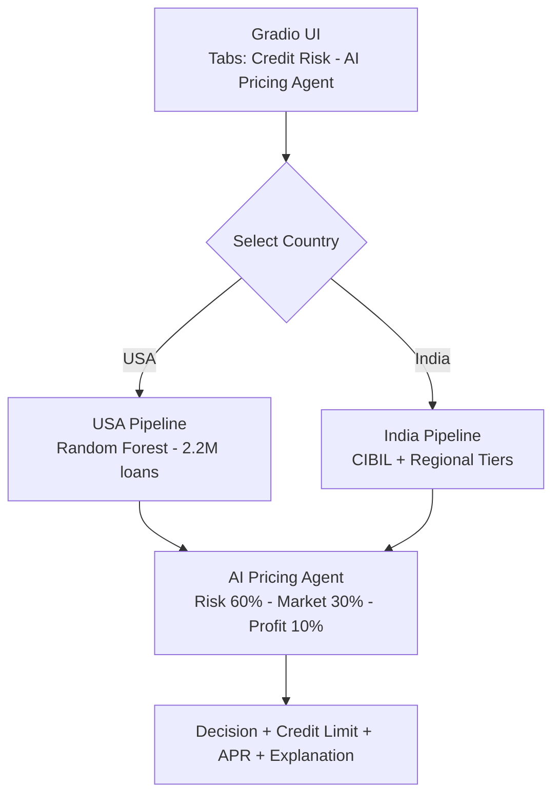

# 💳 CreditAI Global — Smart Credit Approval System

AI-powered dual-market credit assessment system for **USA 🇺🇸** and **India 🇮🇳**, with a built-in AI pricing agent.

🔗 **Live Demo:** [huggingface.co/spaces/sivasaiatchyut/creditai-global](https://huggingface.co/spaces/sivasaiatchyut/creditai-global)

---

## 🎥 Walkthrough

### USA Credit Application


### USA — Full Form with Prediction


### USA — Assessment Result (Approved, Medium Risk)


### India Credit Application (HDFC Credila Style)


### India — Assessment Result (Approved, ₹52,954 Credit Limit)


---

## 🎯 What It Does

| Market | Scoring System | Verification | Supported Cards |
|---|---|---|---|
| 🇺🇸 USA | FICO + Random Forest (86.5% AUC-ROC) | SSN | Visa, Mastercard, Amex, Discover |
| 🇮🇳 India | CIBIL + regional risk | PAN & Aadhaar | Visa, Mastercard, RuPay, Amex |

**AI Pricing Agent:** multi-factor weighted optimization (risk 60% / market 30% / profit 10%) → applicant-specific credit limits and interest rates with explainable reasoning.

---

## 🏗 Architecture



---

## 🧠 Technology Stack

- **ML:** scikit-learn (Random Forest Classifier), joblib
- **UI:** Gradio 4.31.0
- **Data:** 2.2M Lending Club loans (training), pandas, numpy
- **Deployment:** Hugging Face Spaces (free tier, Python 3.11)
- **Model artifacts:** stored via Git LFS

---

## 📊 Model Performance

- **ROC-AUC:** 86.5%
- **Training set:** 2.2M loan records from Lending Club
- **Features:** 17+ engineered features (DTI, utilization, delinquency count, account age, inquiries, bankruptcy indicators)
- **Preprocessing pipeline:** imputer + scaler, persisted via joblib

---

## 🚀 Run Locally

```bash
git clone https://github.com/ShivVIT2019/creditai-global.git
cd creditai-global
pip install -r requirements.txt
python app.py
```

Open http://localhost:7860 in your browser.

---

## 📦 Project Structure
creditai-global/
├── app.py # Gradio entry point
├── agent_tab.py # AI pricing agent UI
├── agent/ # Pricing agent logic
├── ml/
│ └── artifacts/ # Trained model + preprocessors (Git LFS)
├── docs/images/ # Screenshots for README
├── requirements.txt
└── README.md

---

## 🌐 Deployment Notes

Deployed on **Hugging Face Spaces** (free tier) after migrating from Google Cloud Run. Full deployment walkthrough: [`DEPLOYMENT.md`](./DEPLOYMENT.md).

---

## 👨‍💻 Author

**Sivasai Atchyut Akella** (Atchu)
MS Computer Science (AI concentration), Binghamton University
- 🔗 Portfolio: [portfolio-nine-rho-36.vercel.app](https://portfolio-nine-rho-36.vercel.app)
- 💼 LinkedIn: [linkedin.com/in/atchyut](https://linkedin.com/in/atchyut)
- 💻 GitHub: [@ShivVIT2019](https://github.com/ShivVIT2019)

---

## 📄 License

MIT License

> ⚠️ Research and portfolio demonstration. Not a substitute for professional credit decisioning or regulated financial advice.
